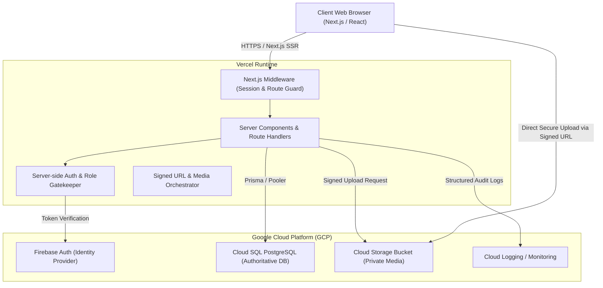

# System Architecture Specification
## Enterprise Dating & Relationship Platform (Conextion)

### 1. Executive Summary & System Boundaries
Conextion is an enterprise-grade, adults-only (18+) discovery and relationship platform engineered for maximum privacy, safety, verified eligibility, and high-performance matchmaking.

The system is deployed on a modern hybrid cloud topology:
- **Application & Edge Layer**: Next.js App Router deployed on Vercel with Edge/Serverless runtimes.
- **Identity & Authentication**: Firebase Authentication combined with HTTP-only, secure, partitioned session cookies verified server-side via Firebase Admin SDK.
- **Authoritative Primary Data Layer**: Google Cloud SQL for PostgreSQL (with connection pooling via Prisma ORM & PgBouncer / Direct SSL) backed by strict relational integrity, or Cloud Firestore with Firebase Admin SDK.
- **Media & Binary Storage**: Google Cloud Storage / Firebase Storage with signed URLs, strict MIME verification, client-side encryption support, and automated content safety/moderation gates.
- **Observability & Audit**: Google Cloud Logging, structured JSON audit trails, and application error tracking.



---

### 2. Technology Stack & Rationale

| Layer | Selected Technology | Version / Spec | Architecture Rationale |
| :--- | :--- | :--- | :--- |
| **Framework** | Next.js (App Router) | v15.x / React 19 / TypeScript 5.x | Server Components for zero-bundle data fetching, Route Handlers for robust REST APIs, built-in Edge middleware. |
| **Language** | TypeScript (Strict Mode) | `strict: true`, `noImplicitAny: true` | End-to-end type safety across schemas, API contracts, and components. |
| **Styling** | Tailwind CSS + Lucide Icons | v3.4+ / Radix UI primitives | Accessible, design-token-driven UI without runtime CSS overhead. |
| **Identity** | Firebase Authentication + Session Cookies | Firebase Admin SDK + Client SDK | Multi-factor authentication (MFA), passwordless/email-pass, secure token issuance, native rate-limiting. |
| **Primary Database** | Cloud SQL for PostgreSQL | PostgreSQL 16 | Relational consistency, ACID transactions for blocks/reports/consent, robust indexing, spatial/similarity queries. |
| **ORM / Data Client** | Prisma ORM | v6.x | Type-safe query builder, declarative schema migrations, connection pooling compatibility. |
| **Object Storage** | Google Cloud Storage / Firebase Storage | Signed URLs (v4) | Ephemeral signed URLs, zero media exposure through application server memory, private buckets. |
| **Hosting & CI/CD**| Vercel + GitHub Actions | Enterprise Git-driven previews | Automated preview deployments, branch isolation, edge routing. |

---

### 3. Data Ownership & Lifecycle Boundaries

```
[Ephemeral Identity Token] -> Issued by Firebase Auth
         |
         v
[Authoritative Internal Member Profile] -> Owned exclusively by Cloud SQL `users` & `user_profiles`
         |
         +---> [Eligibility & Verification Records] -> Owned by `eligibility_checks` (Immutable / Audit Only)
         +---> [Consent Records] -> Owned by `consent_records` (Cryptographic hash & timestamp)
         +---> [Safety & Block Graphs] -> Owned by `blocks` & `reports`
         +---> [Media Metadata & Audit] -> Owned by `profile_photos` & Cloud Storage
```

1. **Authentication Boundary**: Firebase Authentication manages user credentials (email, hashed password, phone number, OAuth tokens). The browser receives an ID token, which is exchanged with the Next.js server for an encrypted, HTTP-only session cookie.
2. **Domain Data Boundary**: All user profile attributes, relationship preferences, match preferences, verification statuses, consent grants, and safety blocks are stored strictly in the primary database.
3. **Data Deletion & Retention**:
   - Soft deletion flag (`deleted_at`) applied to member accounts.
   - 30-day grace period during which matches and discovery are hidden.
   - Hard purge executes scheduled deletion across relational tables and storage blobs, retaining only anonymized `audit_logs` required for legal and compliance tracking.

---

### 4. Authentication Flow & Session Management

```mermaid
sequenceDiagram
    autonumber
    actor User as Browser User
    participant App as Next.js Client
    participant API as Next.js Route Handler (/api/auth/session)
    participant FB as Firebase Auth
    participant DB as Cloud SQL (PostgreSQL)

    User->>App: Submits Email & Password
    App->>FB: signInWithEmailAndPassword()
    FB-->>App: Returns Firebase ID Token (JWT)
    App->>API: POST /api/auth/session { idToken }
    API->>FB: admin.auth().verifyIdToken(idToken)
    FB-->>API: Validated Token Claims (uid, email, email_verified)
    API->>DB: Query or upsert user by firebase_uid
    DB-->>API: User record + Role permissions
    API->>FB: admin.auth().createSessionCookie(idToken, { expiresIn })
    FB-->>API: Cryptographic Session Cookie
    API-->>App: Set-Cookie: __session=...; HttpOnly; Secure; SameSite=Lax; Path=/
    App-->>User: Redirect to Onboarding / Discovery Feed
```

---

### 5. Authorization & Role-Based Access Control (RBAC)

The application enforces strict server-side authorization at every Route Handler and Server Action. Roles are stored in the database and synchronized to Firebase Custom Claims:

| Role | Scope & Permissions |
| :--- | :--- |
| `member` | Read/write own profile, preferences, photos; read public/eligible profiles; create match interactions; report/block other members. |
| `moderator` | Access moderation queue; approve/reject photos; review flagged profiles and reports; issue temporary content warnings. |
| `support_agent` | View customer profile status, eligibility logs, audit records; handle verification appeals (no access to private messages). |
| `finance_admin` | Access subscription tiers, payment audit logs, billing reconciliation. |
| `safety_admin` | Issue account suspensions, permanent bans, review law-enforcement compliance requests, manage blocked device hashes. |
| `super_admin` | Full platform administration, system configuration, role assignment, database maintenance. |

---

### 6. Deployment Topology & Networking

- **Vercel Edge / Serverless**: Next.js route handlers run across Vercel serverless functions in the `iad1` (US-East) or designated multi-region edge.
- **Cloud SQL PostgreSQL Connectivity**:
  - Direct connection using SSL with Cloud SQL Public IP with authorized IP ranges or Neon/Supabase pooling proxy.
  - Integration with Cloud SQL Auth Proxy or Google Cloud Run VPC Connector if private VPC peering is required.
  - Connection pooling managed via Prisma Accelerate or PgBouncer to prevent connection exhaustion during high-concurrency serverless spikes.
- **Environment Isolation**:
  - `development`: Local Node.js + Local/Neon Postgres + Firebase Auth Emulator or Dev Firebase Project.
  - `preview`: Vercel Preview Deployments + Cloud SQL Staging Instance + Firebase Staging Project.
  - `production`: Vercel Production + Highly Available Cloud SQL Instance + Firebase Production Project.

---

### 7. Recovery, Backup & Disaster Planning
1. **Automated Backups**: Nightly automated Cloud SQL snapshots retained for 30 days, with point-in-time recovery (PITR) enabled.
2. **Media Redundancy**: Multi-region or dual-region Google Cloud Storage bucket with object versioning enabled.
3. **Failover**: Multi-AZ standby replica in Cloud SQL with automated failover under 60 seconds.
