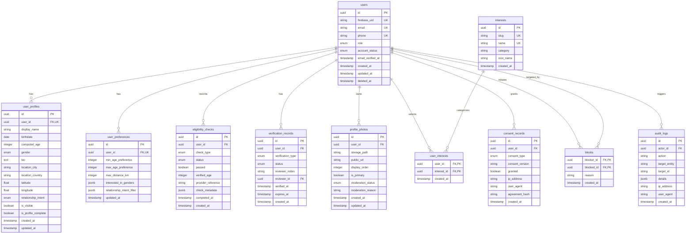

# Database Architecture & Schema Specification
## Enterprise Dating & Relationship Platform (Conextion)

---

### 1. Mandatory Database Decision & Rationale

#### Selected Authoritative Primary Database: **Google Cloud SQL for PostgreSQL 16**

#### Evaluation Matrix: PostgreSQL vs. Cloud Firestore

| Criterion | Cloud SQL for PostgreSQL (Selected) | Cloud Firestore (Document Alternative) |
| :--- | :--- | :--- |
| **Integrity & Constraints** | Native foreign keys, unique composite indexes, check constraints (`age >= 18`). Prevents orphan records. | No native schema constraints; integrity must be fully implemented in application code or security rules. |
| **Safety & Moderation Blocks** | Strict relational exclusion: `WHERE id NOT IN (SELECT blocked_id FROM blocks WHERE user_id = :current_user)`. Single atomic query. | Document queries cannot filter against arbitrary unindexed arrays of dynamic user blocklists without client-side leaks or fan-out reads. |
| **Consent & Audit Immutability** | ACID transactional guarantees; audit log append-only triggers and write-once compliance. | Document writes can achieve atomicity via batch/transactions, but lack relational audit joins. |
| **Matchmaking & Discovery** | Rich SQL operators: geospatial distance, range filters (age, distance, intent), array intersections (interests). | Limited composite querying; requires index-heavy combinations or external search engines (Algolia/Typesense). |
| **Vercel Serverless Connectivity** | Requires connection pooling (PgBouncer, Prisma Accelerate, or Supabase Pooler) to avoid socket starvation. | Native HTTP/2 gRPC API handles high serverless connection concurrency out of the box. |

#### Architectural Verdict
**Google Cloud SQL for PostgreSQL** is selected as the sole authoritative primary store for user accounts, profiles, preferences, eligibility records, consent logs, blocks, and audits.

**Firebase Integration Policy**: Firebase Authentication handles authentication credentials and user UID generation. The `users.firebase_uid` unique column forms the immutable foreign-key boundary. No transactional member data is duplicated or split into Firestore without an explicit reconciliation service.

---

### 2. Vercel Serverless Connection Strategy

Because Vercel serverless functions scale up and down dynamically, direct unbounded connections to PostgreSQL can quickly exhaust Cloud SQL `max_connections` (e.g., 100–500).

```
Vercel Serverless Edge / Node Runtime
                |
         [Prisma Client]
                |
                v
 [Connection Pooler (PgBouncer / Prisma Accelerate)]
  - Transaction-mode pooling
  - SSL/TLS Enforced
  - Keepalive & Idle timeout (10s)
                |
                v
[Google Cloud SQL for PostgreSQL (Primary Instance)]
```

- **Environment Variables**:
  - `DATABASE_URL`: Connection string routed through the pooling proxy (port 6543 / PgBouncer mode) with `pgbouncer=true&connection_limit=10`.
  - `DIRECT_URL`: Direct connection string (port 5432) reserved exclusively for running schema migrations via Prisma Migrate.
- **SSL Configuration**: Cloud SQL SSL Certificates (`server-ca.pem`, `client-cert.pem`, `client-key.pem`) or SSL mode `require` enforced.

---

### 3. Core Relational Schema Specification

#### 3.1 Entity Relationship Diagram



---

### 4. Detailed Data DDL & Constraints

#### Table: `users`
- `id`: `UUID` Primary Key default `gen_random_uuid()`.
- `firebase_uid`: `VARCHAR(128)` NOT NULL, UNIQUE, Indexed.
- `email`: `VARCHAR(255)` NOT NULL, UNIQUE, Indexed.
- `role`: `ENUM ('member', 'moderator', 'support_agent', 'finance_admin', 'safety_admin', 'super_admin')` DEFAULT `'member'`.
- `account_status`: `ENUM ('pending_verification', 'active', 'suspended', 'deactivated', 'banned')` DEFAULT `'pending_verification'`.
- `email_verified_at`: `TIMESTAMPTZ` NULLABLE.
- `created_at`: `TIMESTAMPTZ` NOT NULL DEFAULT `NOW()`.
- `updated_at`: `TIMESTAMPTZ` NOT NULL DEFAULT `NOW()`.
- `deleted_at`: `TIMESTAMPTZ` NULLABLE (Soft delete).

#### Table: `user_profiles`
- `id`: `UUID` Primary Key.
- `user_id`: `UUID` NOT NULL, UNIQUE, REFERENCES `users(id)` ON DELETE CASCADE.
- `display_name`: `VARCHAR(50)` NOT NULL.
- `birthdate`: `DATE` NOT NULL.
- `computed_age`: `INT` NOT NULL (CHECK `computed_age >= 18`).
- `gender`: `VARCHAR(32)` NOT NULL.
- `bio`: `TEXT` NULLABLE (Max 500 characters).
- `location_city`: `VARCHAR(100)` NULLABLE.
- `location_country`: `VARCHAR(100)` NULLABLE.
- `latitude`: `DOUBLE PRECISION` NULLABLE.
- `longitude`: `DOUBLE PRECISION` NULLABLE.
- `relationship_intent`: `ENUM ('dating', 'long_term', 'casual', 'friendship', 'open_to_options')` NOT NULL.
- `is_visible`: `BOOLEAN` NOT NULL DEFAULT TRUE.
- `is_profile_complete`: `BOOLEAN` NOT NULL DEFAULT FALSE.
- `created_at`: `TIMESTAMPTZ` NOT NULL DEFAULT `NOW()`.
- `updated_at`: `TIMESTAMPTZ` NOT NULL DEFAULT `NOW()`.

#### Table: `eligibility_checks` (Age & Identity Assurance)
- `id`: `UUID` Primary Key.
- `user_id`: `UUID` NOT NULL, REFERENCES `users(id)` ON DELETE CASCADE.
- `check_type`: `ENUM ('age_gate_self_attest', 'id_document_scan', 'facial_age_estimation', 'third_party_kyc')` NOT NULL.
- `status`: `ENUM ('pending', 'approved', 'rejected', 'expired')` NOT NULL DEFAULT `'pending'`.
- `passed`: `BOOLEAN` NOT NULL DEFAULT FALSE.
- `verified_age`: `INT` NULLABLE.
- `provider_reference`: `VARCHAR(255)` NULLABLE.
- `check_metadata`: `JSONB` NULLABLE.
- `completed_at`: `TIMESTAMPTZ` NULLABLE.
- `created_at`: `TIMESTAMPTZ` NOT NULL DEFAULT `NOW()`.

#### Table: `consent_records` (Legal & Privacy Compliance)
- `id`: `UUID` Primary Key.
- `user_id`: `UUID` NOT NULL, REFERENCES `users(id)` ON DELETE CASCADE.
- `consent_type`: `ENUM ('terms_of_service', 'privacy_policy', 'age_certification_18plus', 'community_guidelines', 'cookies_analytics')` NOT NULL.
- `consent_version`: `VARCHAR(20)` NOT NULL.
- `granted`: `BOOLEAN` NOT NULL DEFAULT TRUE.
- `ip_address`: `VARCHAR(45)` NOT NULL.
- `user_agent`: `TEXT` NOT NULL.
- `agreement_hash`: `VARCHAR(64)` NOT NULL.
- `created_at`: `TIMESTAMPTZ` NOT NULL DEFAULT `NOW()`.

#### Table: `blocks` (Safety Boundary)
- `blocker_id`: `UUID` NOT NULL, REFERENCES `users(id)` ON DELETE CASCADE.
- `blocked_id`: `UUID` NOT NULL, REFERENCES `users(id)` ON DELETE CASCADE.
- `reason`: `TEXT` NULLABLE.
- `created_at`: `TIMESTAMPTZ` NOT NULL DEFAULT `NOW()`.
- Primary Key: `(blocker_id, blocked_id)`.
- Index: `CREATE INDEX idx_blocks_lookup ON blocks(blocker_id, blocked_id);`
- Index: `CREATE INDEX idx_blocks_reverse ON blocks(blocked_id);`

#### Table: `profile_photos`
- `id`: `UUID` Primary Key.
- `user_id`: `UUID` NOT NULL, REFERENCES `users(id)` ON DELETE CASCADE.
- `storage_path`: `VARCHAR(512)` NOT NULL.
- `public_url`: `VARCHAR(1024)` NOT NULL.
- `display_order`: `SMALLINT` NOT NULL DEFAULT 0.
- `is_primary`: `BOOLEAN` NOT NULL DEFAULT FALSE.
- `moderation_status`: `ENUM ('pending_review', 'approved', 'rejected', 'flagged')` NOT NULL DEFAULT `'pending_review'`.
- `moderation_reason`: `TEXT` NULLABLE.
- `created_at`: `TIMESTAMPTZ` NOT NULL DEFAULT `NOW()`.
- `updated_at`: `TIMESTAMPTZ` NOT NULL DEFAULT `NOW()`.

#### Table: `audit_logs` (Security & Administrative Trail)
- `id`: `UUID` Primary Key.
- `actor_id`: `UUID` NULLABLE, REFERENCES `users(id)` ON DELETE SET NULL.
- `action`: `VARCHAR(100)` NOT NULL.
- `target_entity`: `VARCHAR(64)` NOT NULL.
- `target_id`: `VARCHAR(128)` NULLABLE.
- `details`: `JSONB` NULLABLE.
- `ip_address`: `VARCHAR(45)` NULLABLE.
- `user_agent`: `TEXT` NULLABLE.
- `created_at`: `TIMESTAMPTZ` NOT NULL DEFAULT `NOW()`.

---

### 5. Migration and Rollback Strategy
1. **Schema Management**: All changes are defined in version-controlled Prisma schema migrations (`prisma/schema.prisma`).
2. **Deterministic Versioning**: Migrations executed via `prisma migrate deploy` in CI/CD pipeline prior to traffic cutover.
3. **Zero-Downtime Rule**:
   - Column additions must be nullable or have safe database defaults.
   - Column removals follow a 2-stage deploy: first deprecate from application code, next drop column in subsequent migration.
4. **Data Isolation Tests**: Automated integration tests verify that queries for member $A$ never return records belonging to member $B$, and that blocked users are omitted from all discovery queries.
