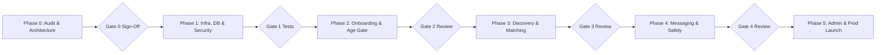

# Implementation Roadmap & Phase Gate System
## Enterprise Dating & Relationship Platform (Conextion)

---

### Phase Roadmap Overview

---

### Detailed Phase Specifications

#### Phase 0: Project Audit and Architecture (Current)
- **Objectives**: Complete inventory of repository state, tooling, dependencies, external cloud resources, architectural specifications, database decision, and security model.
- **Deliverables**:
  - `docs/architecture.md`
  - `docs/database-design.md`
  - `docs/security-model.md`
  - `docs/implementation-roadmap.md`
  - `docs/integration-register.md`
- **Gate 0 Criteria**:
  - Comprehensive evidence-based summary of existing state.
  - Formal selection and justification of Cloud SQL PostgreSQL.
  - Identification of all required environment variables and cloud dependencies.
  - Formal approval of Phase 1 implementation plan.

---

#### Phase 1: Infrastructure, Database and Security Foundation
- **Objectives**: Establish the complete modern full-stack scaffolding, database schema, session authentication, RBAC, and secure media upload architecture.
- **Tasks**:
  1. Initialize Next.js 15 (App Router) with TypeScript, Tailwind CSS, and standard configuration files (`tsconfig.json`, `next.config.ts`, `tailwind.config.ts`, `postcss.config.js`).
  2. Configure ESLint, Prettier, and Vitest / Jest testing infrastructure.
  3. Initialize Prisma ORM with PostgreSQL provider and create schema migrations for:
     - `users`
     - `user_profiles`
     - `user_preferences`
     - `eligibility_checks`
     - `verification_records`
     - `profile_photos`
     - `interests`
     - `user_interests`
     - `consent_records`
     - `blocks`
     - `audit_logs`
  4. Implement Firebase Admin and Client SDK integration:
     - Session cookie generation and verification (`/api/auth/session`).
     - Route middleware for session validation and route guarding.
     - Role authorization helper (`requireRole`, `requireOwnership`).
  5. Implement Google Cloud Storage signed URL generation and upload validation (`/api/media/upload-url`, `/api/media/confirm`).
  6. Create synthetic seed data and automated tests for authentication, authorization, and database isolation.
- **Gate 1 Criteria**:
  - `npm run build` / `pnpm build` succeeds without type or lint errors.
  - Automated tests pass for:
    - Session validation and invalidation.
    - Database CRUD and foreign key cascades.
    - Role authorization rejection (e.g. member denied moderator endpoints).
    - Data isolation (cannot query or mutate another user's private data).
    - Media upload validation (rejects invalid MIME types and oversize payloads).

---

#### Phase 2: User Onboarding, Profile Management & Adult Verification
- **Objectives**: Deliver the complete member registration, 18+ age verification gate, legal consent collection, and profile creation experience.
- **Tasks**:
  1. Registration flow with Firebase Authentication + DOB collection.
  2. Server-side age calculation and validation (strict rejection if <18 years old).
  3. Terms of Service, Privacy Policy, and 18+ certification consent recording with cryptographic hash.
  4. Profile completion wizard:
     - Bio, gender, relationship intent, city/country location.
     - Interest selector (multi-tag taxonomy).
     - Photo upload manager with drag-and-drop, cropping, primary photo selection, and preview.
  5. Automated photo moderation hook (`moderation_status` flow).
- **Gate 2 Criteria**:
  - Underage registration is strictly prevented and audited.
  - Profile completion updates `user_profiles.is_profile_complete = true`.
  - Photos are uploaded directly to GCS via signed URLs and marked `pending_review`.

---

#### Phase 3: Discovery Engine, Preference Filtering & Real-time Matching
- **Objectives**: Implement discovery matchmaking with strict preference filtering, distance calculation, mutual swipe interactions, and instant block filtering.
- **Tasks**:
  1. Discovery feed API with optimized SQL:
     - Age filter (`min_age_preference` to `max_age_preference`).
     - Distance radius filter using haversine formula / geospatial queries.
     - Gender and intent compatibility.
     - **Bidirectional Block Exclusion**: Excludes all profiles where either party has blocked the other.
  2. Interactive card deck UI with swipe/pass/superlike actions, responsive gestures, and keyboard navigation.
  3. Match detection: When mutual like occurs, create `matches` record and trigger mutual match notification.
  4. Search preferences drawer allowing members to adjust discovery radius, age range, and filters in real time.
- **Gate 3 Criteria**:
  - Zero leakage of blocked users in discovery feed.
  - Latency of discovery query < 150ms under synthetic 10,000-user database load.
  - Mutual like correctly generates verified match.

---

#### Phase 4: Secure Messaging, Privacy Controls & Safety Tools
- **Objectives**: Enable private member-to-member conversations with robust safety tools, real-time messaging, instant block/unmatch, and reporting flows.
- **Tasks**:
  1. Messaging schema (`conversations`, `messages`, `message_reports`).
  2. Route Handlers for sending messages, reading thread history, and typing indicators.
  3. Safety actions:
     - 1-Click "Block & Unmatch" (instantly revokes chat access for both users).
     - "Report User" flow (captures report category, optional message snapshot, and submits to moderation queue).
     - Safety center modal with emergency helplines and dating safety tips.
- **Gate 4 Criteria**:
  - Non-matched users cannot send messages (enforced at API layer).
  - Blocked user cannot view conversation or send messages.
  - User reports create verifiable audit records in moderation queue.

---

#### Phase 5: Administration, Moderation Dashboard & Deployment
- **Objectives**: Build the back-office administration suite for moderators and safety officers, complete end-to-end testing, and prepare production deployment.
- **Tasks**:
  1. Moderation Portal (`/admin/moderation`):
     - Photo review queue (Approve / Reject / Flag).
     - User report triage queue.
  2. Safety Admin Portal (`/admin/safety`):
     - Ban/suspend accounts, view eligibility logs, view audit trail.
  3. End-to-end integration test suite using Playwright.
  4. Vercel deployment configuration (`vercel.json`) and GitHub Actions CI workflow.
- **Gate 5 Criteria**:
  - 100% of critical paths covered by automated tests.
  - Clean production build with zero security vulnerabilities.
  - All staging/production environment variables documented and verified.
