# Conextion Phase Gates & Quality Standards

This document defines the formal milestone phase gates, entry criteria, verification evidence, and exit sign-off rules for the Conextion Enterprise Dating & Relationship Platform.

---

## Phase Gate Matrix Overview

```mermaid
flowchart LR
    Gate0["Gate 0: Greenfield Architecture"] --> Gate1["Gate 1: Infra & Security Foundation"]
    Gate1 --> Gate2["Gate 2: Member Experience & Matching"]
    Gate2 --> Gate3["Gate 3: Messaging & Real-time SSE"]
    Gate3 --> Gate4["Gate 4: Trust, Safety & Privacy"]
    Gate4 --> Gate5["Gate 5: Subscriptions & Payments"]
    Gate5 --> Gate6["Gate 6: Enterprise Admin & Analytics"]
    Gate6 --> Gate7["Gate 7: Production Launch & Audit"]
```

---

## Gate 0 — Greenfield Architecture, Google Cloud SQL & Vercel Setup

- **Objective**: Establish foundational architecture, security boundaries, database specifications, dependency inventory, and cloud connectivity runbooks.
- **Key Deliverables**:
  - `docs/architecture.md`: Modular monolith architecture, data flow, trust boundaries, tech stack.
  - `docs/database-design.md`: Cloud SQL PostgreSQL 16 schema, ERD, pooling strategy, index definitions.
  - `docs/security-model.md`: Defense-in-depth, RBAC model, PII confidentiality, session cookies.
  - `docs/deployment-runbook.md`: Cloud SQL setup, least-privilege DB grants, Vercel deployment, PITR rollback.
  - `docs/phase-gates.md`: Formal criteria for each phase gate.
  - `docs/integration-register.md`: Cloud dependencies and manual user action prerequisites.
  - `.env.example` & `.gitignore`: Safe configuration template excluding real secrets.
- **Verification Evidence**:
  - Node.js & package manager version verification (`node -v`, `pnpm -v`).
  - Absence of hardcoded credentials in source control.
  - Verified presence of all architectural artifacts.
- **Exit Criteria**: Client review and sign-off on architecture and database plan before application construction.

---

## Gate 1 — Infrastructure, Database & Security Foundation

- **Objective**: Implement base project structure, database migrations, centralized RBAC, Firebase session cookie engine, and signed object storage.
- **Key Deliverables**:
  - Next.js 15 App Router, TypeScript strict mode, Tailwind CSS UI component system.
  - Prisma schema with core 11 entities and initial migration (`prisma/migrations/20261014000000_init_core_entities`).
  - Centralized RBAC engine (`lib/auth/rbac.ts`) with 6 initial roles (`member`, `moderator`, `support_agent`, `finance_admin`, `safety_admin`, `super_admin`).
  - Session cookie engine (`lib/auth/session.ts`, `lib/auth/firebase-admin.ts`) using HTTP-only `__session` cookies.
  - Google Cloud Storage private media service (`lib/storage/gcs.ts`) with V4 signed upload and view URLs.
- **Verification Evidence**:
  - `tests/environment.test.ts`: Environment validation.
  - `tests/database.test.ts`: DMMF schema and constraint verification.
  - `tests/rbac.test.ts`: Role privilege hierarchy and cross-account access rejection.
  - `tests/auth.test.ts`: Session creation, verification, and revocation.
  - `tests/storage.test.ts`: V4 signed URL generation and MIME enforcement.
- **Exit Criteria**: Zero mock auth; passing test suite; clean compilation and Git commit (`162f15f`).

---

## Gate 2 — Member Experience, Profiles & Matching

- **Objective**: Resumable onboarding wizard, candidate discovery feed, server-side compatibility scoring, and mutual matching engine.
- **Key Deliverables**:
  - Multi-step onboarding wizard (`/onboarding`) enforcing 18+ adult age certification, biography, photos, and preferences.
  - Server-side candidate discovery engine (`lib/matching/discovery.ts`, `/api/discovery`) with bidirectional block and pass exclusions.
  - Explainable compatibility recommendation algorithm (`lib/matching/compatibility.ts`).
  - Atomic mutual matching engine (`lib/matching/interactions.ts`, `/api/interactions`, `/api/matches`).
  - Member discovery feed UI (`/discovery`), matches screen (`/matches`), profile management (`/profile`).
- **Verification Evidence**:
  - `tests/matching-gate2.test.ts`: Atomic mutual matching, reciprocal swipe triggers, duplicate swipe prevention, bidirectional unmatching, and unauthenticated 401 guards.
- **Exit Criteria**: 38 passing tests; zero placeholder UI; clean build and Git commit (`8baf42d`).

---

## Gate 3 — Messaging & Notifications

- **Objective**: Persistent conversations, real-time message delivery, delivery receipts, unread counters, and safety-filtered notifications.
- **Key Deliverables**:
  - Conversation service (`lib/messaging/conversation-service.ts`) scoped strictly to authorized match parties.
  - Server-Sent Events (SSE) real-time streaming transport (`app/api/messages/stream/route.ts`) with 15s keepalive heartbeat.
  - In-memory event bus (`lib/messaging/event-bus.ts`) for real-time delivery and read receipt dispatch.
  - Client idempotency key engine (`client_message_id`) preventing duplicate messages on network retries.
  - In-app notification engine (`lib/notifications/notification-service.ts`) omitting sensitive message content from notification previews.
  - Chat interface (`/messages`, `/messages/[id]`) with auto-reconnecting EventSource.
- **Verification Evidence**:
  - `tests/messaging-gate3.test.ts`: Event bus broadcasting, read receipts, clientMessageId deduplication, delivery status transitions, participant authorization guards, and privacy sanitization.
- **Exit Criteria**: 48 passing tests; clean build and Git commit (`75b6d8a`).

---

## Gate 4 — Trust, Safety & Privacy

- **Objective**: Robust incident reporting, SLA triage priority, moderation queue, case notes, appeals workflow, and GDPR data export/deletion.
- **Key Deliverables**:
  - Prisma models: `ModerationCase`, `CaseNote`, `Appeal`, `PrivacyDataRequest` (`migration 20261014030000`).
  - Safety Operations SOP document (`docs/safety-operations.md`).
  - Moderation service (`lib/moderation/moderation-service.ts`) with SLA priority calculation and proactive profile hiding on underage suspicion.
  - Privacy service (`lib/privacy/privacy-service.ts`) generating GDPR Art. 15 JSON archives and 30-day scheduled account deletion.
  - Trust & Safety Console (`/admin/moderation`) and Member Privacy Portal (`/settings/privacy`).
- **Verification Evidence**:
  - `tests/safety-gate4.test.ts`: SLA priority mapping, proactive underage discovery suppression, least-privilege queue access, moderator ban rejection (requires safety_admin), bidirectional block integrity, appeal due process, and PII protection.
- **Exit Criteria**: 65 passing tests; zero ESLint warnings; clean build and Git commit (`db9ea0e`).

---

## Gate 5 — Subscriptions & Payments

- **Objective**: Configurable Free, Plus, and Premium plans, Stripe Checkout integration, signed webhook validation, idempotency, server-side entitlements, and reconciliation.
- **Key Deliverables**:
  - Plan configuration (`lib/subscriptions/plans.ts`) with strictly server-evaluated entitlements and quotas (Free: 25 likes, Plus: unlimited likes & 5 rewinds, Premium: see admirers & priority discovery).
  - Safety rule: Blocking, reporting, messaging with matches, and privacy operations are NEVER paywalled.
  - Stripe integration (`lib/subscriptions/stripe-client.ts`, `lib/subscriptions/payment-service.ts`) with cryptographic webhook signature validation and `webhook_events` deduplication.
  - Server-side entitlement service (`lib/subscriptions/entitlements-service.ts`).
  - Reconciliation service (`lib/subscriptions/reconciliation-service.ts`) auditing internal subscriptions against remote provider records.
  - Membership & Billing Portal (`/settings/subscription`).
- **Verification Evidence**:
  - `tests/subscriptions-gate5.test.ts`: Plan configurations, test mode enforcement, invalid webhook signature rejection, duplicate webhook idempotency, subscription checkout/renewal/cancellation/expiration/refund transitions, and quota enforcement.
- **Exit Criteria**: 83 passing tests; clean build and Git commit (`cb07e8e`).

---

## Gate 6 — Enterprise Administration & Analytics

- **Objective**: Centralized enterprise administration console, database-backed statistical analytics, customer support helpdesk, policy CMS, and system diagnostics.
- **Key Deliverables**:
  - Enterprise Admin Console (`/admin/dashboard`) with role-specific views for Super Admin, Safety Admin, Moderators, Support Agents, Finance Admins, and Analytics Viewers.
  - Added `analytics_viewer` role to `UserRole` and RBAC matrix.
  - Database-backed analytics engine (`lib/admin/analytics-service.ts`) calculating registrations, active members, completion rate, match conversion, retention cohorts, revenue, and mean resolution time without individual tracking.
  - Customer Support Helpdesk (`lib/admin/support-service.ts`) managing tickets, agent assignment, confidential internal notes, and one-click safety escalation.
  - Policy & FAQ CMS (`lib/admin/support-service.ts`, `/api/content/policies`) allowing Super Admins to edit live terms and guidelines.
  - System health diagnostics (`lib/admin/admin-service.ts`, `/api/admin/health`) with live Cloud SQL ping.
- **Verification Evidence**:
  - `tests/admin-gate6.test.ts`: Role-specific privilege validation, analytics formula accuracy, support ticket thread masking, safety escalation, and role modification justification guards.
- **Exit Criteria**: 96 passing tests across 10 test files; 48 routes compiled; clean build and Git commit (`f67f810`).

---

## Gate 7 — Production Readiness, Operations & Full Lifecycle Verification

- **Objective**: Complete end-to-end user lifecycle verification, operational runbooks, infrastructure readiness audit, and final production validation.
- **Key Deliverables**:
  - Comprehensive End-to-End Verification Suite (`tests/e2e-production-readiness.test.ts`) covering all 7 core journeys:
    1. Adult Age Assurance & Privacy Safeguards (underage blocking, DOB/GPS hiding).
    2. Candidate Discovery Engine, Explainable Compatibility & Bidirectional Blocking.
    3. Mutual Matching, Real-Time Messaging & Idempotency Key deduplication.
    4. Trust & Safety, Moderation Escalation & Due Process Appeals.
    5. Subscriptions & Unpaywalled Safety (Free/Plus/Premium tiers, webhook deduplication, zero paywall for safety/reporting/mutual chat).
    6. GDPR Art. 15 Data Export & Art. 17 Right to Erasure.
    7. Enterprise Administration, Role-Based Access Control & Immutable Audit Logging.
  - Production Deployment Runbook (`docs/deployment-runbook.md`) covering Google Cloud SQL PostgreSQL 16 sizing, PgBouncer pooling, Vercel edge deployment, secrets management, and automated backup/PITR recovery.
  - Trust & Safety Operations Manual (`docs/safety-operations.md`) covering triage matrix, SLA targets, evidence handling, appeal workflows, and law enforcement escalation.
  - 48 compiled production routes with zero lint warnings and zero TypeScript errors.
- **Verification Evidence**:
  - `tests/e2e-production-readiness.test.ts`: 17 comprehensive lifecycle integration tests validating all platform capabilities.
  - Full automated suite: 113 passing tests across 11 test suites with 100% success rate.
- **Exit Criteria**: 113 passing automated tests; 0 TypeScript errors; 0 ESLint warnings; 48 compiled production routes; clean build and Git commit.

