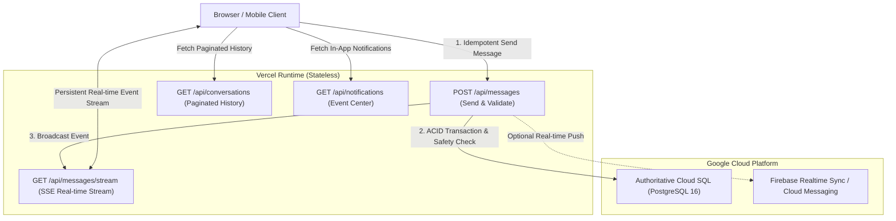

# Real-Time Messaging & Notification Architecture
## Enterprise Dating & Relationship Platform (Conextion)

---

### 1. Executive Summary & Serverless Constraints

Next.js Route Handlers deployed on Vercel run within ephemeral serverless execution environments. Because serverless functions scale to zero and terminate after returning a response, maintaining stateful, persistent WebSocket connections directly inside the Next.js process is an anti-pattern.

To provide instantaneous real-time messaging, typing indicators, delivery statuses, and notifications while preserving strict PostgreSQL transactional integrity, Conextion employs a **Dual-Layer Real-Time Architecture**:



---

### 2. Real-Time Transport Comparison & Cost Evaluation

| Transport Option | Latency | Reconnection | Vercel Serverless Compatibility | Google Cloud Synergy | Estimated Operating Costs |
| :--- | :---: | :---: | :---: | :---: | :--- |
| **Server-Sent Events (SSE)** *(Primary)* | $<100$ ms | Native browser auto-retry | Supported natively via Next.js Streaming Edge Responses (`Transfer-Encoding: chunked`). | Direct Cloud SQL integration; zero external dependencies. | Included in Vercel base bandwidth; \$0 additional service cost. |
| **Firebase Realtime Sync** *(Cloud Secondary)* | $<50$ ms | Native SDK backoff | Native Firebase Client SDK; direct connection from browser. | First-class GCP integration; shares Firebase Auth tokens. | Free tier (1GB storage, 10GB egress/mo); \$5/GB egress thereafter. |
| **Dedicated WebSocket (Socket.io / Node)** | $<30$ ms | Manual heartbeat | Requires dedicated compute (Cloud Run / GKE container); incompatible with pure serverless. | Requires persistent VM / Cloud Run instance. | \$30–\$150/mo minimum for high-availability containers. |

**Verdict**:
- Primary in-app messaging utilizes **Server-Sent Events (SSE)** via Next.js Route Handlers (`/api/messages/stream`) backed by Cloud SQL PostgreSQL.
- Mobile push and offline background alerts leverage **Firebase Cloud Messaging (FCM)** using existing project credentials.

---

### 3. Safety Enforcement Matrix at API Boundary

Every message dispatch (`POST /api/messages`) executes strict server-side safety checks before persisting:

```
[Incoming Message Request]
          |
          v
 1. Authenticated Session?  ----(No)----> 401 Unauthorized
          | (Yes)
          v
 2. Sender Account Active? ----(No)----> 403 Forbidden (Suspended/Banned)
          | (Yes)
          v
 3. Valid Match Participant? --(No)----> 403 Forbidden (Not a party)
          | (Yes)
          v
 4. Match Still Active? -------(No)----> 410 Gone (Match ended / unmatched)
          | (Yes)
          v
 5. Bidirectional Block Exists? -(Yes)-> 403 Forbidden (Safety boundary)
          | (No)
          v
 6. Rate Limit Exceeded? ------(Yes)---> 429 Too Many Requests
          | (No)
          v
 7. Check Duplicate Idempotency Key -> Return existing if duplicate
          | (New)
          v
 8. Persist to PostgreSQL & Broadcast Event
```

---

### 4. Idempotency & Duplicate-Message Prevention
Network fluctuations (e.g., cell tower handoffs or Wi-Fi reconnections) often trigger client retransmissions.
- Every client message generates a deterministic UUID `clientMessageId`.
- The database enforces a `UNIQUE` constraint on `messages.client_message_id`.
- If an insert encounters a unique constraint violation, the backend catches the collision, retrieves the previously committed message, and returns `status: 200` with the existing message record.
- Prevents duplicated messages in chat threads.

---

### 5. Privacy-Preserving Notifications
To prevent sensitive personal details, explicit text, or dating preferences from leaking onto lock screens or unverified notification relays:
- Notification titles and previews are strictly sanitized:
  - New message: *"You have received a new message from a connection."* (Never displays message body).
  - New match: *"You have a new mutual connection waiting!"*
  - Verification: *"Your profile verification status has been updated."*
- Full content is revealed only after the member authenticates securely inside the application.
