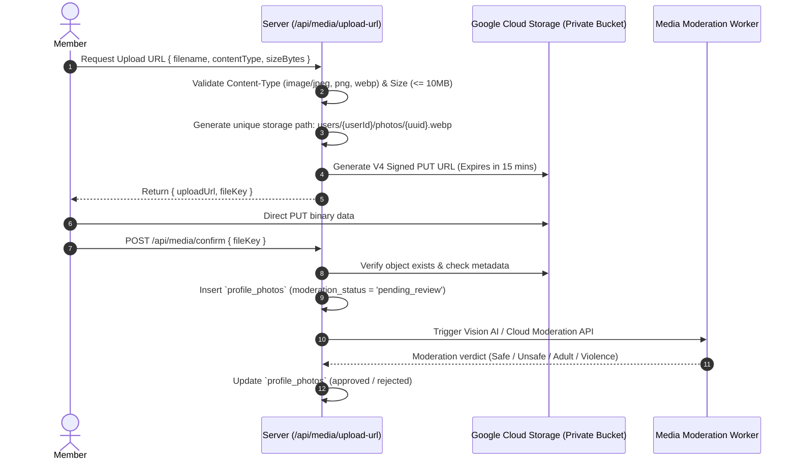

# Security Model & Authorization Architecture
## Enterprise Dating & Relationship Platform (Conextion)

---

### 1. Threat Model & Security Posture
Because Conextion handles sensitive personal discovery data, dating preferences, geolocation, and adults-only eligibility, security and privacy are fundamental system requirements.

The threat model addresses:
- **Underage Access**: Preventing minors (<18) from creating accounts or circumventing age gates.
- **Unauthorized Profile Harvesting / Scraping**: Restricting bulk enumeration of user profiles and contact information.
- **Cross-Account Data Tampering / Insecure Direct Object References (IDOR)**: Enforcing server-side authorization on every mutation and private retrieval.
- **Harassment & Stalking**: Enforcing bidirectional block and report graphs at the database query level.
- **Media Leakage & Malicious Uploads**: Rejecting unmoderated or malicious files via signed URLs, MIME validation, and private storage buckets.
- **Credential Stuffing & Session Hijacking**: Implementing MFA, session revocation, and secure cookie hygiene.

---

### 2. Authentication & Session Security

```mermaid
flowchart TD
    User([Browser Client]) -->|Email / Password + Optional MFA| FBAuth[Firebase Identity Provider]
    FBAuth -->|ID Token Valid for 1 Hour| User
    User -->|POST /api/auth/session| NextServer[Next.js Server Route]
    NextServer -->|Verify Signature & Claims| FBAdmin[Firebase Admin SDK]
    FBAdmin -->|Create Session Cookie (Valid 5-14 Days)| NextServer
    NextServer -->|Set-Cookie: __session| User
    User -->|Protected Request + Cookie| EdgeMiddleware[Next.js Middleware]
    EdgeMiddleware -->|Decrypt & Validate Session Cookie| AuthContext[Authorized Request Context]
```

1. **Authentication Engine**: Firebase Authentication acts as the identity provider (IdP).
2. **Session Cookie Architecture**:
   - Client sends Firebase ID Token to `/api/auth/session`.
   - Server uses `firebase-admin/auth` `verifyIdToken(idToken, true /* checkRevoked */)`.
   - Server issues a session cookie using `createSessionCookie` with an expiration between 5 days and 14 days.
   - Cookie attributes: `HttpOnly; Secure; SameSite=Lax; Path=/; Priority=High`.
3. **Session Revocation**:
   - On password change, security alert, or admin suspension, `admin.auth().revokeRefreshTokens(uid)` is called.
   - Next.js server validates token revocation timestamps on every sensitive operation.

---

### 3. Role-Based Access Control (RBAC) Matrix

Server-side authorization is enforced by a centralized guard utility: `requireRole(req, allowedRoles)` and `requireOwnership(actorId, resourceOwnerId)`.

| Permission / Action | `member` | `moderator` | `support_agent` | `finance_admin` | `safety_admin` | `super_admin` |
| :--- | :---: | :---: | :---: | :---: | :---: | :---: |
| **Manage Own Profile & Preferences** | ✅ | ✅ | ✅ | ✅ | ✅ | ✅ |
| **Browse / Match Discovery** | ✅ | ❌ | ❌ | ❌ | ❌ | ❌ |
| **Block / Report Users** | ✅ | ❌ | ❌ | ❌ | ❌ | ❌ |
| **View Moderation Queue (Photos/Reports)** | ❌ | ✅ | ❌ | ❌ | ✅ | ✅ |
| **Approve / Reject Photos** | ❌ | ✅ | ❌ | ❌ | ✅ | ✅ |
| **View Support Tickets & User Status** | ❌ | ❌ | ✅ | ❌ | ✅ | ✅ |
| **View Billing & Subscription Records** | ❌ | ❌ | ❌ | ✅ | ❌ | ✅ |
| **Issue Bans / Suspensions** | ❌ | ❌ | ❌ | ❌ | ✅ | ✅ |
| **View Audit Logs & Compliance Data** | ❌ | ❌ | ❌ | ❌ | ✅ | ✅ |
| **Assign Admin Roles & Manage System**| ❌ | ❌ | ❌ | ❌ | ❌ | ✅ |

> [!IMPORTANT]
> Administrative and moderation roles must never have access to private member chat contents, except when a specific message is formally reported with cryptographic consent for review.

---

### 4. Adults-Only Eligibility & Age Assurance (18+)
Under no circumstances may users under 18 access discovery or messaging.

1. **Gate 1 — Strict Self-Attestation & Date of Birth (DOB) Validation**:
   - DOB must be provided during account registration.
   - Server computes age:
     $$\text{Age} = \text{floor}\left(\frac{\text{Current Date} - \text{Birthdate}}{365.25 \text{ days}}\right)$$
   - If $\text{Age} < 18$, the registration is rejected immediately, and an immutable log entry is generated in `eligibility_checks`.
2. **Gate 2 — Identity Verification (IDV) Integration**:
   - Higher-trust badges or flagged accounts require third-party ID document verification (e.g. Veriff, Persona, or Jumio).
   - Document images are processed by the IDV provider and are never stored permanently in application storage to minimize GDPR/CCPA liability.
3. **Gate 3 — Anti-Spoofing & Device Fingerprinting**:
   - Accounts created from IP addresses or devices associated with banned or underage attempts are flagged for manual verification before activation.

---

### 5. Consent Tracking & Regulatory Compliance
To satisfy GDPR, CCPA, and adult safety compliance mandates:
1. **Immutable Consent Logs**:
   - Each consent grant (Terms of Service, Privacy Policy, 18+ Certification) stores the exact policy version, user IP address, User-Agent, timestamp, and a SHA-256 hash of the agreement text.
2. **Right to Be Forgotten**:
   - Account deletion triggers an automated purge cascade across user photos, bio, preferences, and matching records.
   - Audit logs are retained in anonymized format (`actor_id = NULL`, `hashed_id` kept for legal compliance).

---

### 6. Media Storage & Upload Security Pipeline



1. **Zero Direct Application Buffer**: Client uploads directly to Google Cloud Storage via short-lived signed URLs. The Next.js application server never buffers large media in memory.
2. **Content Verification**: Signed URLs enforce `Content-Type` and `Content-Length-Range`.
3. **Private Buckets**: The storage bucket is completely private (`Uniform bucket-level access`, all public reads disabled). Photos are served either via signed CDN URLs or approved proxy routes.

---

### 7. Network & Application Defense
- **Cross-Origin Resource Sharing (CORS)**: Strict origin whitelisting (`APP_URL`).
- **Content Security Policy (CSP)**:
  `default-src 'self'; script-src 'self' 'unsafe-eval' https://apis.google.com; img-src 'self' data: https://storage.googleapis.com; connect-src 'self' https://*.firebaseio.com https://identitytoolkit.googleapis.com;`
- **Rate Limiting**: Distributed rate-limiting (Upstash Redis or in-memory token bucket) for:
  - Auth routes: 5 attempts per 15 minutes per IP.
  - Discovery swipes/views: 60 requests per minute per authenticated user.
  - Profile reports: 10 reports per hour per user.
